<div align="center">

# Claude Cowork 30 分钟超全教程

### 从项目管理、模型选择，到 Skill、Connector、Plugin，一次讲透

</div>

<br>

> **本文整理自 B站 @檀东东 的《Claude Cowork 30 分钟超全教程》。**
>
> 内容涵盖项目管理、任务管理、模型选择、多级 Instructions 撰写、Memory 管理、Skill 配置、Connector 配置等。刚上手时确实有很多卡点和疑惑的地方，这篇文章结合十几个案例把它们融会贯通，帮你快速上手。

<br>

---

<br>

## 本文目录

1. Claude 桌面端三件套：Chat / Cowork / Code
2. 界面初识：「+」号里藏着什么
3. 模型怎么选：Sonnet / Opus + 自适应思考
4. 完整上手流程：从 Start a New Project 开始
5. 三级 Instructions：Folder / Project / Global
6. 两种 Memory：历史对话与自动生成记忆
7. Context 窗口里的两个关键文件
8. 自带 Skills：一句话搞定 Office 三件套
9. Customize：Connectors / Skills / Plugins
10. 能力小结：一条清晰的扩展路径
11. Scheduled：定时任务与每日简报
12. Live Artifacts：永久保存在 Cowork 里的实时面板
13. Dispatch：用手机远程指挥电脑
14. Computer Use 与 Claude in Chrome
15. 写在最后

<br>

---

<br>

## 一、Claude 桌面端三件套：Chat / Cowork / Code

Claude 桌面端已经把 **Chat、Cowork、Code 三合一**了。三者分工不同：

- **Code** —— 给程序员用；
- **Chat** —— 和 Claude 网页版完全同步；
- **Cowork** —— 给白领用，能和电脑里的文件、软件、浏览器网页协同工作。

需要留意的是，**Cowork 本身也是 Chat + Work + Code 三合一**。

> 💡 本质上，这几个都是 Agent。

另外有个新手容易踩的坑：**Claude 桌面端免费版只有 Chat**，Cowork 和 Code 都需要开通 $20 的月度会员才能使用。

**Chat 的 Projects 和 Cowork 的 Projects 不是一回事：**

| | Chat 的 Projects | Cowork 的 Projects |
| :--- | :--- | :--- |
| 作用 | 把相关的对话组织到一起 | 组织工作任务 |
| 在哪里干活 | 在**云端** | 以**本地文件系统**为基础 |
| 能否操作本地文件 | 不能 | 能读写、创建、修改电脑里的文件 |
| 成果落在哪 | 云端对话里 | 直接落在电脑硬盘里 |

而且，Chat 里的 Project 可以**导入到 Cowork 里面进一步深加工**。

<p align="center">
  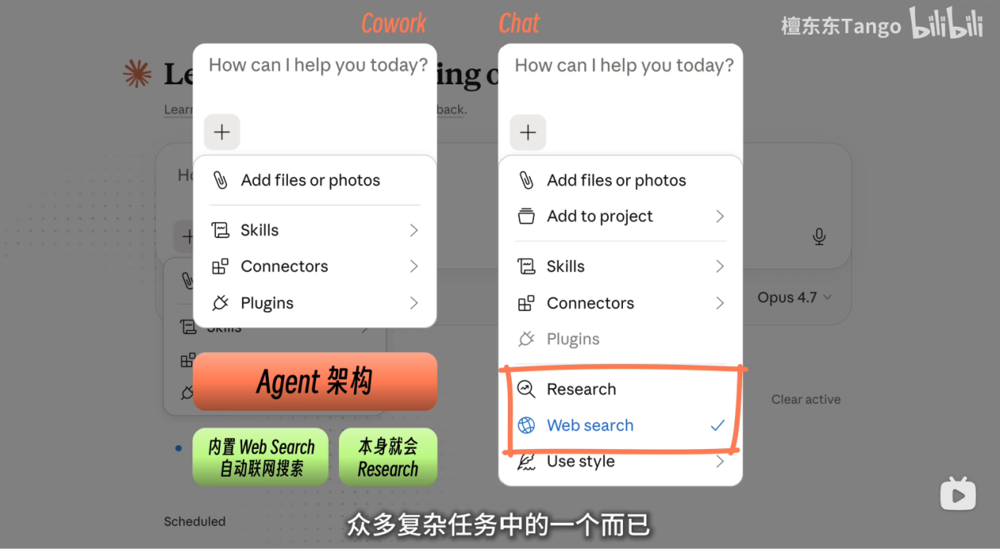
</p>

<p align="center"><sub>图：Claude 桌面端三合一，Cowork 面向本地文件系统工作</sub></p>

<br>

---

<br>

## 二、界面初识：「+」号里藏着什么

先认识一下 Claude Cowork 的初始界面。

输入框旁边的 **「+」是能力扩展**，里面包含**附件、Skills、Connector、Plugin**。

这里有个很值得琢磨的细节：对比 Cowork 对话框的「+」和 Chat 模式下对话框的「+」，你会发现 **Cowork 这里没有 Web Search 和 Research**。

原因是：**Cowork 是 Agent 架构，它的预设 Tool Box 里默认就有 Web Search 工具**。

- Chat 要**手动联网**，Cowork 是**默认联网**；
- Research 只是 Cowork 能完成的众多复杂任务中的一个。

> 📌 所以不是 Cowork 功能少，而是它**把更多的能力内化到了 Agent 的架构里面**。

再看两个常用开关：

- **Work in a project** —— 让用户选择在哪个本地文件夹里工作；
- **Ask before acting / Act without asking** —— 行动前是否请求许可。

> ⚠️ 有用户反馈「Work without asking」会消耗更多 Token。

一个 Project 可以包含**很多个 Chat 窗口**，方便你并行推进不同任务。

<p align="center">
  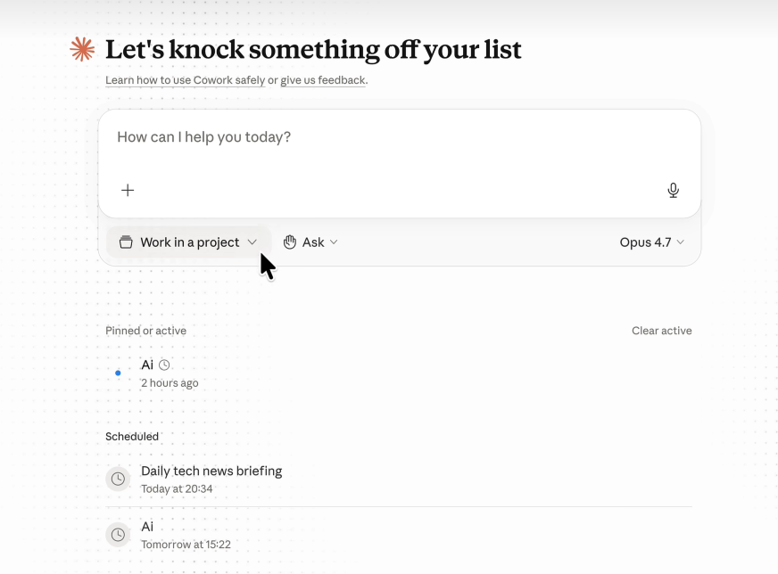
</p>

<p align="center"><sub>图：选择工作文件夹与行动前的权限模式</sub></p>

<br>

---

<br>

## 三、模型怎么选：Sonnet / Opus + 自适应思考

在 Project 里面**开启一个 Chat 窗口之后，后续所用的 LLM 就固定、无法更改了**，所以要预先根据任务人为挑一下模型。

现阶段建议就用两档：

| 任务类型 | 推荐配置 |
| :--- | :--- |
| 简单任务 | **Sonnet + Adaptive Thinking** |
| 复杂任务 | **Opus + Adaptive Thinking** |

> 视频发布时 Fable 还没有推出，实际效果如何有待验证。

如果一定要改，可以在这个 Project 窗口**新开一个 Chat**。

### 关于不同 LLM 消耗 Token 的小知识

从 **Opus 4.7**（现已更新到 Opus 5.5）开始，模型就**只有自适应思考深度**了 —— 前几代模型还需要自己手动选择思考深度，简单问题浅层想，复杂问题深度想。

现在的情况是：

- **关闭 Adaptive Thinking** → 模型就不思考；
- **开启 Adaptive Thinking** → 模型根据问题难易程度，自己在 `low → medium → high → xhigh → max` 之间自适应思考。

所以一些简单的问题，Opus 4.7 能够快速输出，**同时降低了 Token 消耗和延迟**。

> ✅ Anthropic 官方推出的消费端产品已经尽可能做到开箱即用，绝大部分场景都能在**质量、延迟、成本**这三个维度之间取得平衡。

<p align="center">
  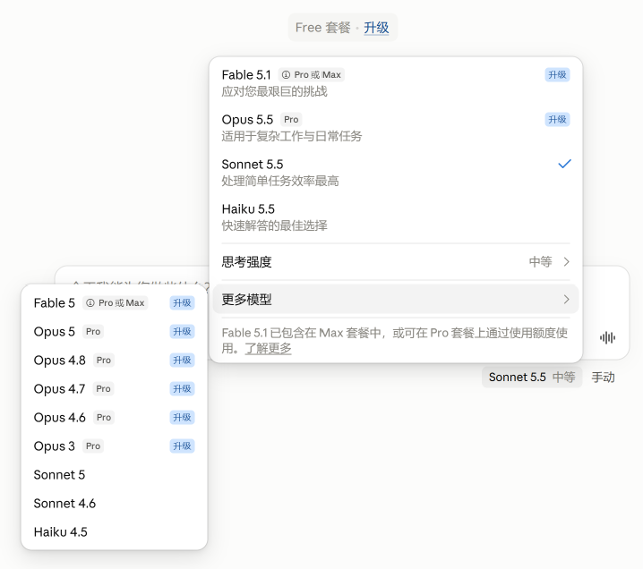
</p>

<p align="center"><sub>图：模型选择界面与 Adaptive Thinking 开关</sub></p>

<br>

---

<br>

## 四、完整上手流程：从 Start a New Project 开始

从 **Start a New Project** 开始，你有三个选择：

1. 在已有的 Claude Cowork Project 中接着做；
2. 从 Claude Chat 的 Project 中导一个过来；
3. 完全新建一个。

具体步骤如下。

### 第一步：选择一个电脑本地的文件夹路径

把它作为**持续工作的专属空间**。之后 Claude 会自动创建一个 Folder，随着时间的推移：

- 相关的 **Context 会积累**；
- 相关的**文件和说明也会保存在这个 Folder 里面**。

<p align="center">
  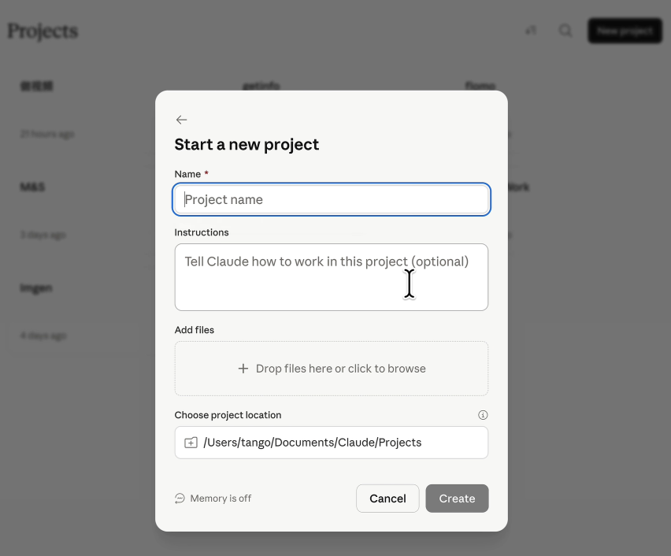
</p>

<p align="center"><sub>图：选择一个本地文件夹作为专属工作空间</sub></p>

<br>

<p align="center">
  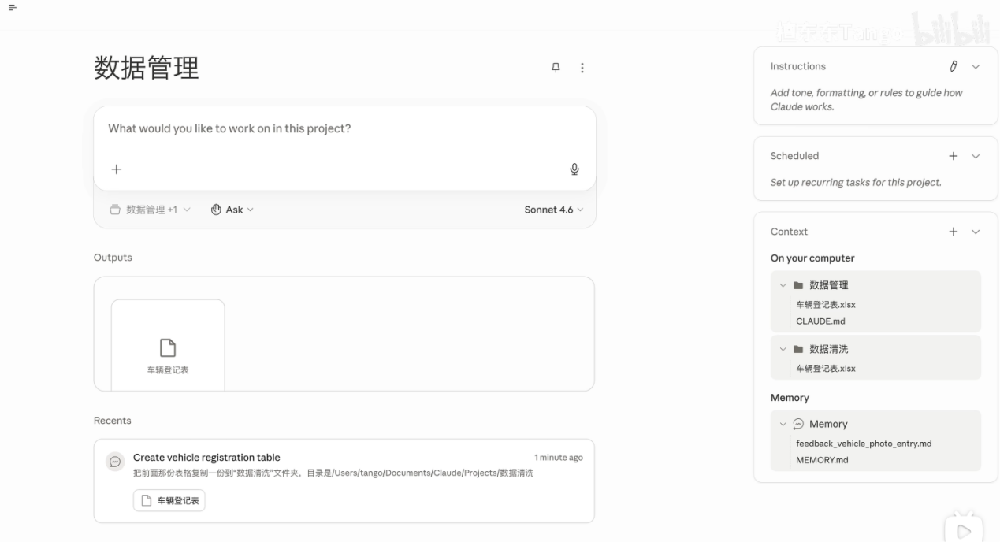
</p>

<p align="center"><sub>图：Folder 创建完成，后续 Context 会持续沉淀在这里</sub></p>

<br>

### 第二步：设置 Project Instructions

Claude Cowork 有**三级 Instructions**：

| 级别 | 名称 | 影响范围 |
| :--- | :--- | :--- |
| 最低 | **Folder Instructions** | 只影响当前工作的 Folder |
| 中级 | **Project Instructions** | 影响本 Project 下所有 Chats 和 Folders |
| 最高 | **Global Instructions** | 影响所有的 Project |

这里设置的是 **Project Instructions**，它会**影响本 Project 下所有 Chats 和 Folders 的行为**。

> 📌 一开始**空着就行**，后续边做边改、慢慢迭代。

至于另外两个：

- **Folder** 是最低级别，下文会讲到；
- **Global** 是最高级别，需要在 **Settings → Cowork** 里面设置，会影响所有的 Project。

> ⚠️ 为避免各级 Instructions 打架，建议在 **Global Instructions 这里只写用户的基础背景信息，别写太细的要求**。

<p align="center">
  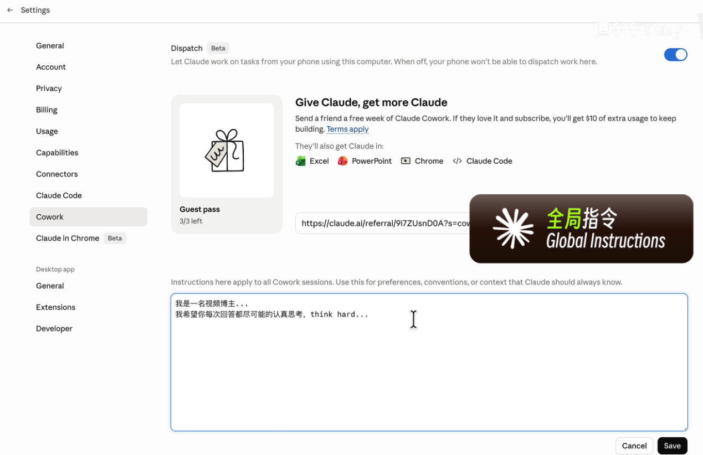
</p>

<p align="center"><sub>图：Global Instructions 在 Settings → Cowork 中设置</sub></p>

<br>

### 第三步：打开 Memory 开关

Claude Cowork 有**两种 Memory，都需要在 Settings 里开关**：

1. **搜索和引用历史 Chats** —— 这个影响 Chats；
2. **Generate memory from chat history** —— 这个影响 Chats，也影响 Cowork。

除此之外，今年年初的时候，**不同 AI 大模型之间就已经具备了记忆相互导入的能力**。

> 🤔 博主的理解是：Chat 部分的 Generate Memory 可以手动修改，Cowork 部分的 Generate Memory 只作用在单一 Project 里面。这一点还需要自己实操验证。

<br>

---

<br>

## 五、三级 Instructions：Folder / Project / Global

这一节把三级 Instructions 讲透，这是 Cowork 用得好不好的关键。

```
Global Instructions    ← 最高级，影响所有 Project（写基础背景信息）
    └── Project Instructions  ← 中级，影响本项目所有 Chats / Folders
            └── Folder Instructions  ← 最低级，只影响当前 Folder
```

**建议的分工：**

- **Global** —— 只写「你是谁」，比如职业、常用工具、语言偏好等基础背景；
- **Project** —— 写这个项目的工作方式和要求；
- **Folder** —— 写具体任务的执行规范。

> 💡 越往下越具体，越往上越通用。这样三级之间就不会互相打架。

<br>

---

<br>

## 六、两种 Memory：历史对话与自动生成记忆

进入 Project 下的一个 Chat 窗口并给 Claude Cowork 布置任务后，**右边就会出现 Context 窗口**。

里面除了用户要它完成的任务文件外的**所有东西都是 Context**，未来每次输入 Prompt 时，这些内容都会作为 Context **一并发给 LLM**。

### 第一个文件：`instruction.md`

它的作用是**作为 Folder Instructions 指引 Claude 干活** —— 在本 Folder 内进行的所有后续工作，都会按照这个 Folder Instructions 的指令进行。

Folder Instructions 是 Claude Cowork 三级 Instructions 中**最低的一级，只影响当前工作的 Folder**。

<p align="center">
  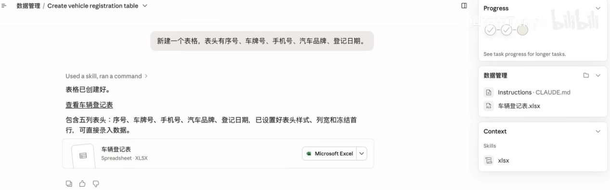
</p>

<p align="center"><sub>图：instruction.md —— 指引 Claude 在当前 Folder 内干活</sub></p>

<br>

### 第二个文件：`memory.md`

**直接在对话框中让 Claude Cowork 记住某事**，Cowork 就会生成一份 `memory.md`，后续的记忆都会一直沉淀在这里。

它会记住**用户通过 Prompt 告诉它的所有偏好和要求**。

<p align="center">
  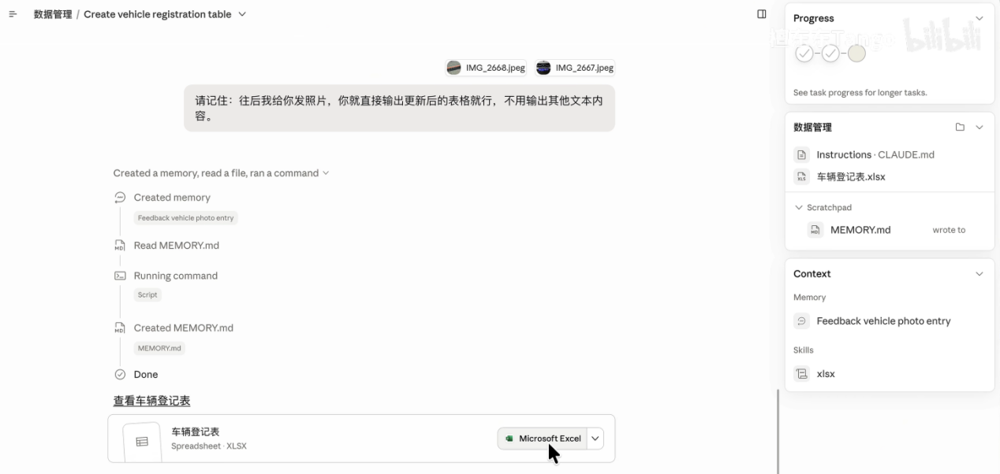
</p>

<p align="center"><sub>图：memory.md —— 你的偏好与要求会持续沉淀在这里</sub></p>

<br>

---

<br>

## 七、Context 窗口里的两个关键文件

简单回顾一下这两个文件的分工：

| 文件 | 作用 | 谁来写 |
| :--- | :--- | :--- |
| `instruction.md` | 作为 Folder Instructions，**指引** Claude 干活 | 你（或让 Claude 代写） |
| `memory.md` | **沉淀**你告诉它的所有偏好和要求 | 对话中一句「记住…」即可生成 |

> 📌 用好这两个文件，Cowork 会越用越懂你。

<br>

---

<br>

## 八、自带 Skills：一句话搞定 Office 三件套

和 Cowork 已经具备的 Skills 有关的工作（比如 **PPT、Excel、Word**），**要做什么直接在 Chat 里面用 Prompt 告诉 AI 就行了**。

举几个例子：

- 改 Excel 颜色；
- 批量改 Word；
- 把 PDF 文档扫描并翻译成 Word 文档；
- 生成格式标准、可编辑的 PPT。

各种东西都能**通过 Prompt 一键完成**。

### 它背后是怎么干的？

Cowork 的工作流程是：

1. **在沙箱里面跑 Python 脚本**；
2. 分别调用 `openpyxl`、`python-docx`、`python-pptx` 这几个库写对应的文档；
3. **PPT / Excel / Word Skills 作为 SOP**，来指导 Cowork 做好这些工作。

> 💡 用户**只需要描述任务目标**，而路径规划、调用什么 Tools，这些 AI 都会自己想办法完成。
>
> 不过想要省 Token 的话，可以先提前和 AI 对齐一些东西。

<p align="center">
  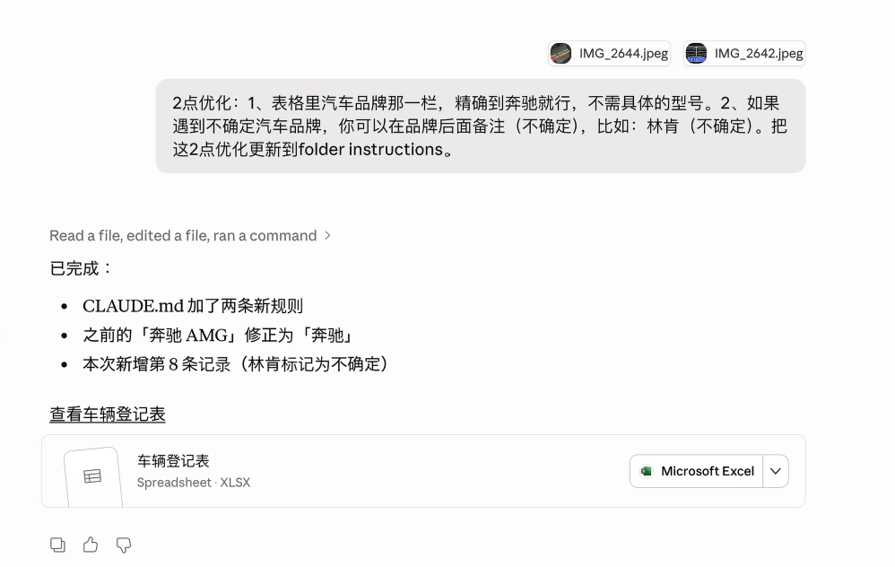
</p>

<p align="center"><sub>图：Cowork 在沙箱中调用 Python 库生成 Office 文档</sub></p>

<br>

<p align="center">
  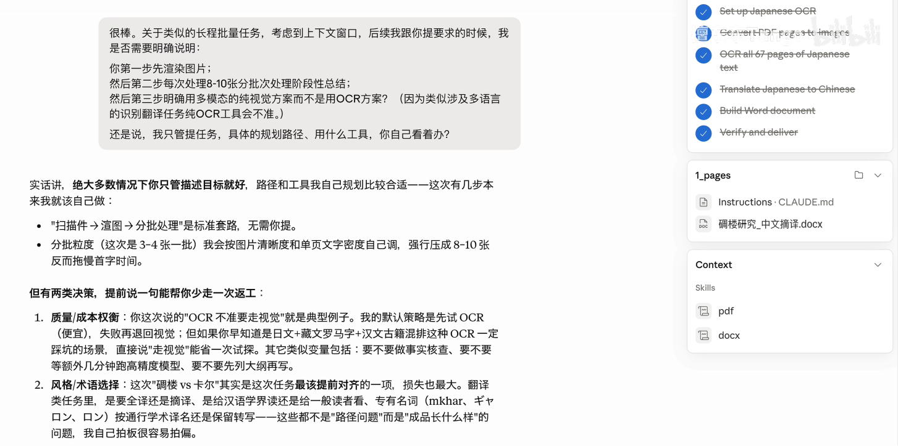
</p>

<p align="center"><sub>图：PPT Skill 作为 SOP 指导文档生成</sub></p>

<br>

### 如果日常用 Microsoft Office 比较多

也可以在 Microsoft 三个 App 内部**安装 Claude 插件**，去 Claude Chat 网页端直接下载就行。

> 🧭 这也说明 **Cowork 干活和 Chat 对话是不一样的**：
>
> - Cowork **以目标为导向**，路径和工具它自己心里有数，错了也会再试；
> - 但如果有需要提前对齐的经验或者要求，**提前说清楚最好**。
>
> Cowork 不会给情绪价值，但**是一个很好的下属** —— 提前对齐要求肯定能省时省力。它还会**反思和改正**，如有需要可以让它把总结反思写进 Folder Instructions 或 Memory。

<br>

---

<br>

## 九、Customize：Connectors / Skills / Plugins

大部分情况下用不着 Customize，**默认的配置已经足够了**。

但如果有需要用到新的 MCP 和 Skills，那就可以在左侧列表的 **Customize** 里定制 Skills 和 Connectors。

<p align="center">
  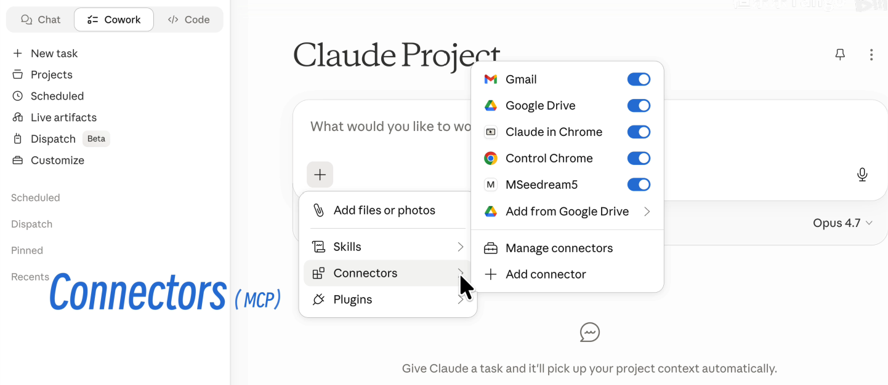
</p>

<p align="center"><sub>图：Customize 入口</sub></p>

<br>

<p align="center">
  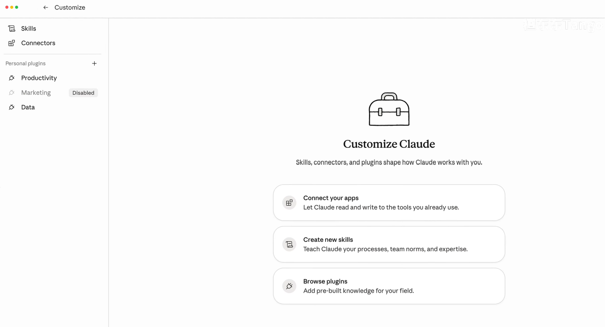
</p>

<p align="center"><sub>图：在 Customize 中定制 Skills 与 Connectors</sub></p>

<br>

### 9.1 Connectors：给 Cowork 接上外部抓手

Cowork 本身提供的**内置能力很多**，比如联网搜索 Tools、读写文件 Tools、沙箱环境 Tools。

但有些常用能力它没有内置提供，比如：

- 代码直接上传 GitHub；
- 图片生成 Tools。

这就需要通过**连接器 / 插件 / MCP** 等方式接入相应的外部能力了。

> 📌 Cowork Connectors 基本上都是**通过 MCP 包装各家 SaaS 服务**。

为了方便用户上手，**Cowork 把 MCP 写成了 Connectors** —— 已经预设好了一些常用 App 的 API，点击即用。

用户用 MCP 连上外部 App 后：

- Cowork 生成的文件会**和这些 App 同步**；
- 生成文件最右侧会**有一列一键跳转外部 App 的按钮**。

<p align="center">
  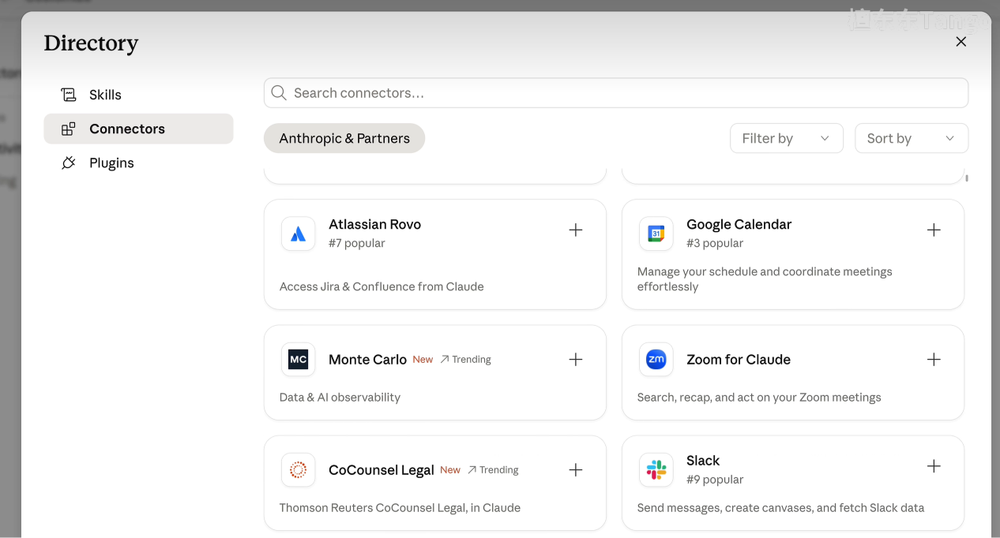
</p>

<p align="center"><sub>图：Connectors 把各家 SaaS 服务包装成即点即用的能力</sub></p>

<br>

**没有预设好的 API 怎么办？**

那就自己**和 Cowork 一起手搓**，但也不难。

比如连 Seedream，**在对话框里和 Cowork 交流十几分钟就能搓出来连上**，然后就可以：

- 直接在对话框里让它文生图；
- 直接让 Cowork 在 PPT 中制作并放置图片。

> 🎨 如果文生图的提示词比较模糊，**Cowork 会在可视化思考中自己对你的提示词进行润色**。

<br>

### 9.2 Skills：内置与扩展

考虑到用户分级问题（普通办公 / 开发），Claude Cowork 自带的 Skills 分为两类：

| 类型 | 说明 | 例子 |
| :--- | :--- | :--- |
| **内置 Skills** | 仅包括大众通用需求的那部分 | Word、Excel、PPT |
| **扩展 Skills** | 需要自己选择是否添加 | `mcp-builder`、`skill-creator` |

<p align="center">
  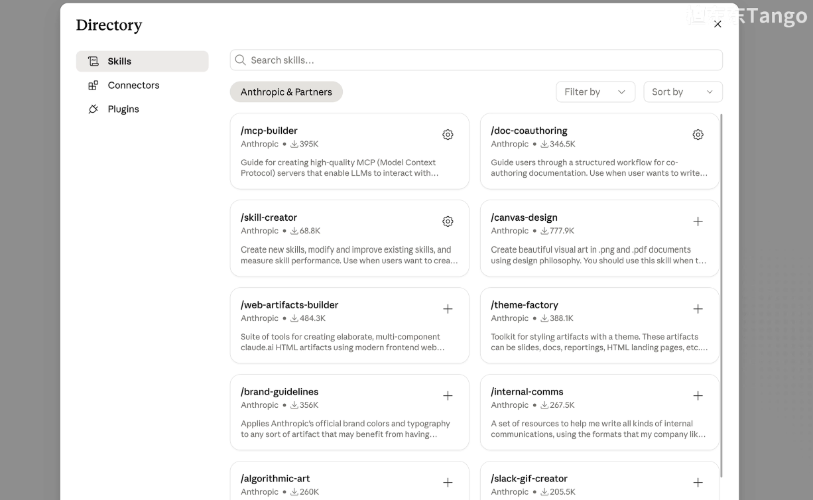
</p>

<p align="center"><sub>图：内置 Skills 与扩展 Skills 的分级</sub></p>

<br>

**什么时候会用到扩展 Skills？**

比如平时有**重复的、批量的工作**，用户想让 Cowork 写一个针对该工作的定制 Skill —— 此时就建议安装扩展 Skills 中的 **Skill Creator**，它的作用**是帮用户把这个 Skill 写得更好**。

安装之后，**用户在对话框用自然语言说明自己想要个什么样的 Skill，Cowork 就会自己写出来**。

<br>

### 9.3 Plugins：整套工作流的打包

最后是 **Plugins**，它的本质是**打包好的整套工作流**。

比如 `productivity` 这个插件，把好几个 Skills 和 Connectors 都打包在一起 —— **这就相当于直接扩展了一个具体的岗位**。

市场营销、数据分析、设计、财务、运营、销售、法务，**都成套打包了**。

<p align="center">
  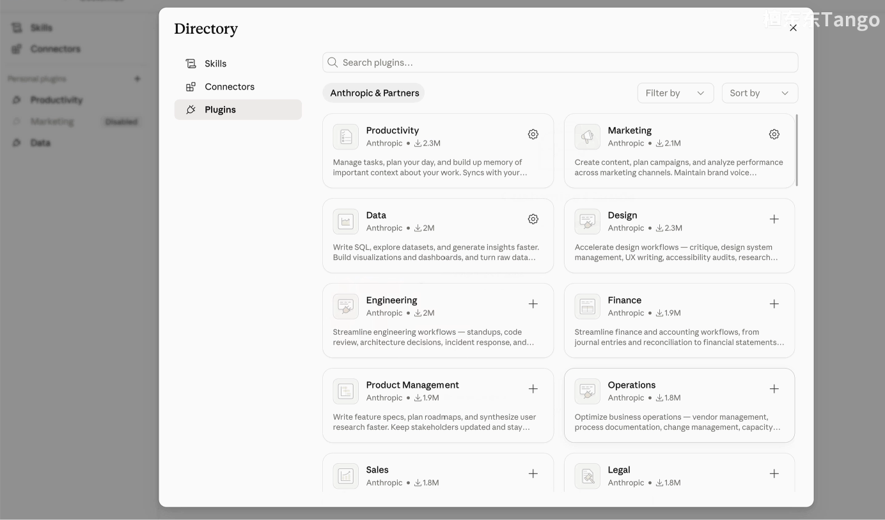
</p>

<p align="center"><sub>图：Plugin = 打包好的整套工作流，相当于扩展一个岗位</sub></p>

<br>

### 延伸：腾讯 WorkBuddy 的「专家」就是借鉴了这个思路

顺便一提，**腾讯 WorkBuddy 的专家概念就是借鉴的 Plugin 概念**。

WorkBuddy 的架构文档显示：**每个专家本质上就是一个 zip 包形式打包的 Plugin Bundle**，和 Claude Plugin 一样，将 Skills、Connectors、Commands、Agents 打包成一个可安装、可分发的单元。

> 🗓️ 今年 3.31 Claude Code 意外泄露了 51 万行代码；就在 10.16，有人发现 CodeBuddy 和 Claude Code 存在 200 多段完全相同的文本，最长连续重合字符接近 500 个。

不过 WorkBuddy 在借鉴时做了一些**缝合**：它的专家团设计了一个「**团长**」。

这个「团长」和专家们不一样 —— **它不是一个岗位插件包，而是进行信息中转和专家组织调用的存在**。

- 所有的专家都要**听从「团长」的调度**；
- **专家之间不直接通信**。

> 💡 这个设计除了借鉴 Claude Plugin，还借鉴了 Claude Code 里的 **Subagent 调度模式**。

<br>

---

<br>

## 十、能力小结：一条清晰的扩展路径

全程都是**以任务为导向，全都交给 Cowork 去干**。按照复杂度，扩展路径分为四层：

| 需求复杂度 | 用什么 |
| :--- | :--- |
| **基础任务需求** | Cowork 框架自带的能力就能胜任 |
| 想连接**外部抓手**干更多活 | 用扩展 Connectors，或者手搓一个 MCP |
| 想让 Cowork 把**一类活干得更好** | 用扩展 Skills，或者手搓一个 Skill |
| 再复杂一点，**整套工作流打包** | 那就上 Plugins |

<p align="center">
  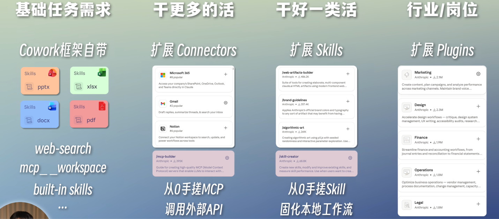
</p>

<p align="center"><sub>图：从自带能力到 Plugins 的四层扩展路径</sub></p>

<br>

### 也不是所有改善都得用上这些

比如博主常用的双端笔记 App **石墨文档**，用了很多年存了几百条轨迹。

他希望：**在微信里刷公众号 / 在浏览器选中重要信息 / 在 LLM 桌面端选中任何文本，都可以直接发送到石墨文档**，而且还可以在发送前**打新标签或选已有标签**。

这时候只需要：

1. 自己先搓好石墨文档的 API；
2. 然后把需求跟 Claude Cowork 说。

**Cowork 就会从脚本创建到跑通测试，一步到位帮忙搞定。**

<br>

---

<br>

## 十一、Scheduled：定时任务与每日简报

接下来还剩三个功能：

1. **Scheduled** —— 定时任务；
2. **Live Artifacts** —— 实时面板；
3. **Dispatch** —— 远程分发。

<p align="center">
  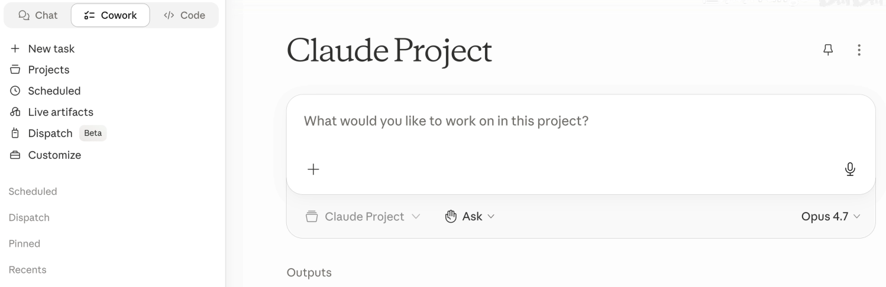
</p>

<p align="center"><sub>图：Scheduled、Live Artifacts、Dispatch 三大功能</sub></p>

<br>

### 最常见的用法：每日简报

点击右上角 **New Tasks → Create with Claude**，跟 Cowork 说要创建一个每日新闻简报，它就会问几个细节：

- 简报包括什么**主题**？
- 什么**时候运行**？
- 用什么**语言输出**？

> 🔗 这个和 Dispatch 结合起来，就很像博主之前用 WorkBuddy 做的每日热门商品推送简报。当时 WorkBuddy 有个 API 叫微信 ClawBot，**电脑端只要开着 WorkBuddy，就能直接通过这个对话窗口接收商品简报**。
>
> 当然，Claude Cowork 这个简报也只有 Claude 开着才能运行，**注意勾选上 Always Awake**。

<p align="center">
  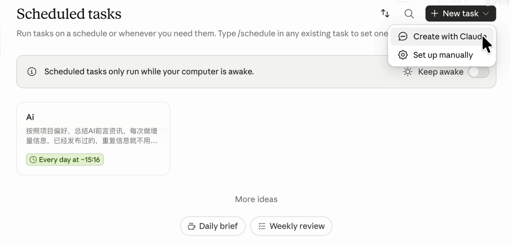
</p>

<p align="center"><sub>图：New Tasks → Create with Claude</sub></p>

<br>

<p align="center">
  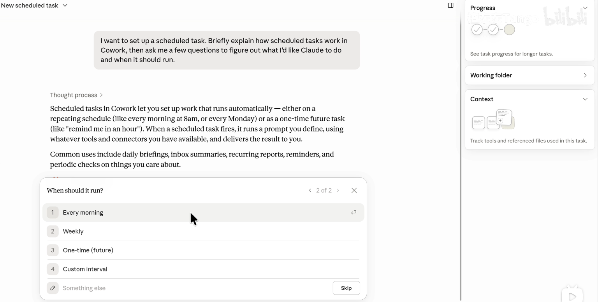
</p>

<p align="center"><sub>图：Cowork 会主动和你对齐主题、时间与输出语言</sub></p>

<br>

<p align="center">
  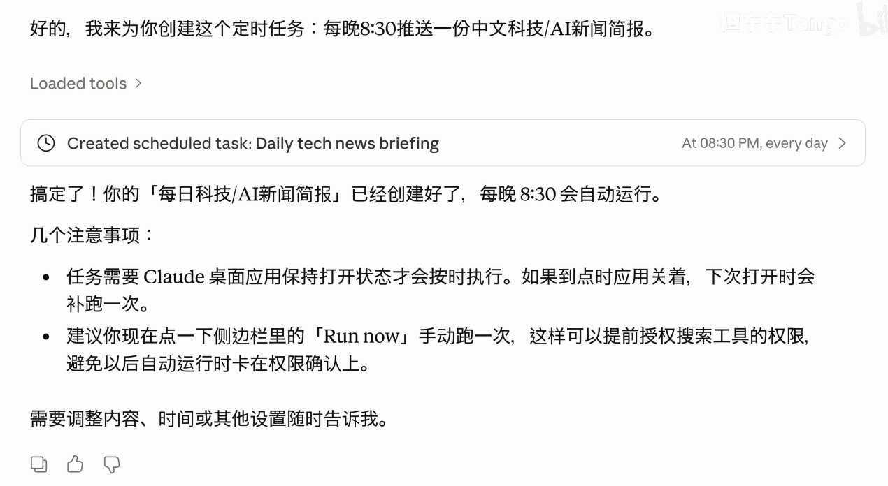
</p>

<p align="center"><sub>图：任务开始运行</sub></p>

<br>

### 编辑与运行

点击 **Edit Scheduled Task**，这里是可以再编辑的工作区域。

选择已经创建好的 Task，**保存并点击 Run Now**，它就会开始搜索中英文信息源，**分分钟就写好了**。

还可以**叠加一个生图的任务** —— 定时输出简报的同时，再调用 Seedream 为第一条简报做一个信息海报。

<p align="center">
  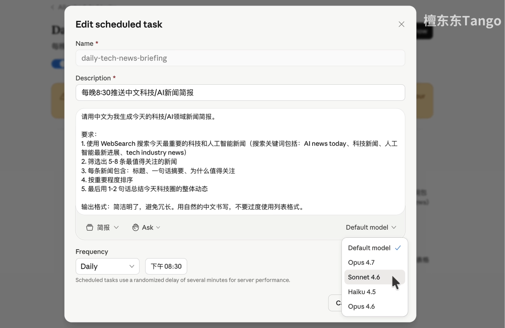
</p>

<p align="center"><sub>图：Edit Scheduled Task 工作区</sub></p>

<br>

### 到了这一步，其实已经可以直接生成一篇公众号文章了

**标题、文案、配图、正文，全都通过 Cowork 一步到位搞定。**

后续优化时，可以：

- 指定**信息源和主题**；
- 改用更厉害的图片生成工具，生成**带文字 + 数据的配图**。

然后**只需要给它公众号后台的 App ID 和 App Secret**，它就能直接生成排版或者完整图文，**存到用户的公众号草稿箱**。

> 🛠️ 排版如果有小问题，**截个屏发给 Cowork，它就会自己调整好**。
>
> 用户只需要过程审核和最后点个发布 —— 或者不需要任何人力，**直接 Auto Publish 就可以**。
>
> 实操一轮过后，可以结合前面所学，**顺手让 Cowork 把这整套工作流固化成一个 Skill，随时都能调用**。

<p align="center">
  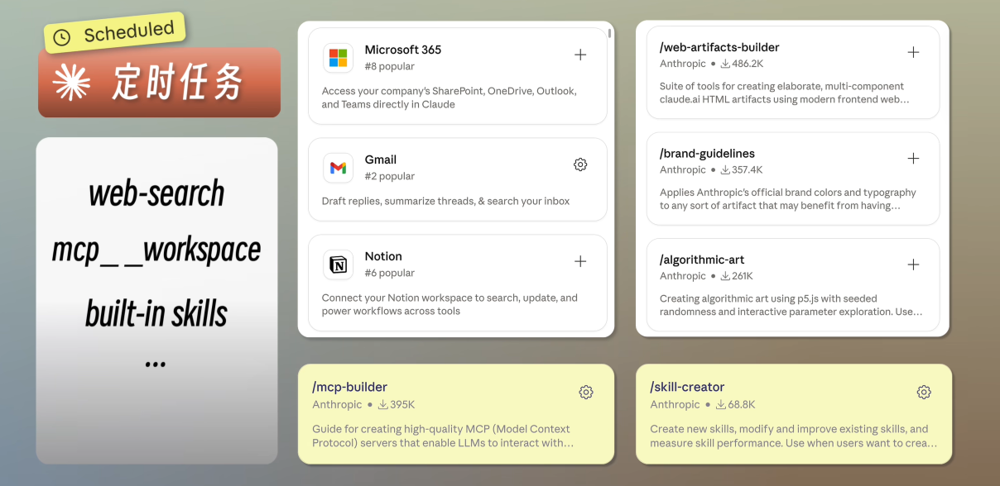
</p>

<p align="center"><sub>图：定时简报的输出成果</sub></p>

<br>

### 做简报只是最低级用法

**其实做简报只是 Cowork 自动化任务的最低级用法。**

知道了它的原理，知道它本身的能力，再加上 **MCP 和 Skill 扩展能力**，你就知道怎么结合自己的需求提出目标 —— **Cowork 都会帮忙实现**。

<br>

---

<br>

## 十二、Live Artifacts：永久保存在 Cowork 里的实时面板

**Live Artifacts 实时面板（活页）**，是一个**永久保存在 Cowork 里面的 HTML 网页**。

用户可以**用 Connector（MCP）连接外部系统，打造一个实时看板**，它会实时自动更新。

> ⚡ 因为要保证**低延迟的实时响应**，默认驱动它的 LLM 是**不聪明但反应快的 Haiku**。

这个建议**以自己实操为准，定制属于自己的实时面板**。

<p align="center">
  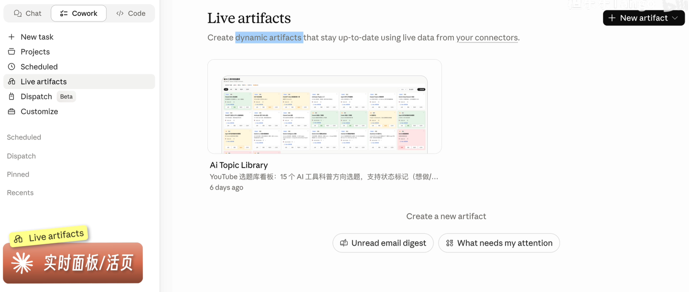
</p>

<p align="center"><sub>图：Live Artifacts 实时看板</sub></p>

<br>

---

<br>

## 十三、Dispatch：用手机远程指挥电脑

最后一个 **Dispatch 远程分发任务** —— 点击 Cowork 主界面最左列的 **Dispatch**，就可以开始跟手机上的 Claude 配对。

<p align="center">
  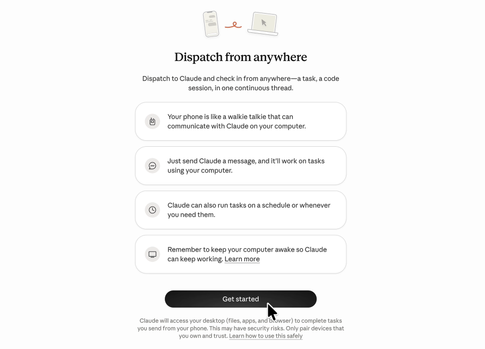
</p>

<p align="center"><sub>图：Dispatch 入口</sub></p>

<br>

进来之后开启如下按钮，这样就能**在手机端 Claude 操控电脑端 Cowork 远程跑任务**：

<p align="center">
  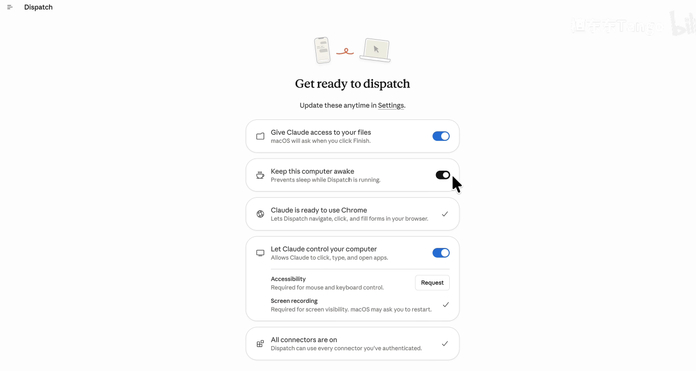
</p>

<p align="center"><sub>图：开启 Dispatch 开关</sub></p>

<br>

<p align="center">
  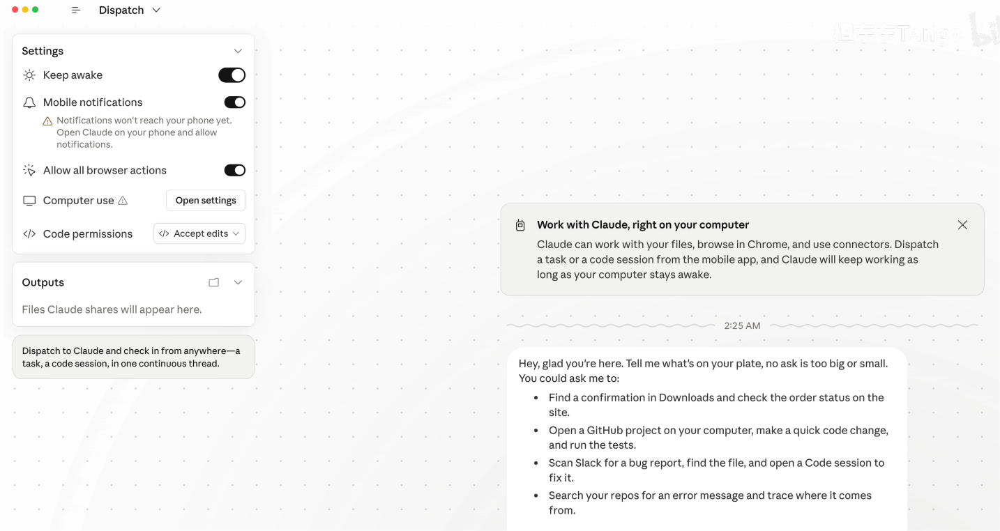
</p>

<br>

<p align="center">
  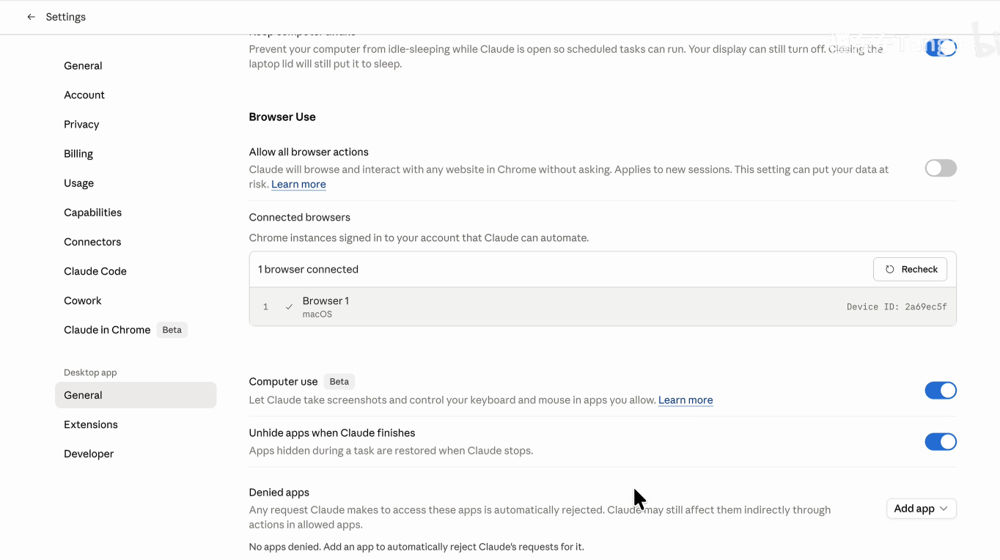
</p>

<p align="center"><sub>图：手机端 Dispatch 界面</sub></p>

<br>

### 两个真实场景

**场景一：线下拍照识别**

回看一下视频开头那个「自动识别车牌和电话号码」的任务 —— 其实**更适合在线下场景，通过 Dispatch 分发**。

直接在手机 App 上点击 Dispatch，让它开启一个任务，然后**只要用手机拍车牌并发给 Cowork**，Cowork 就会**自动在电脑端更新文档并推送给手机端**。

**场景二：手机端写公众号文章**

在手机端 Dispatch 说「新开一个任务窗口」，命名为「写公号文章」，**专门调用之前做的那个公众号写作 Skill 帮忙写文章**。

流程是这样的：

1. 用户只需要在手机聊天窗口**给选题方向和观点**；
2. Cowork 会和用户**对齐要求和一些细节问题**；
3. 确认完毕后就开始做；
4. 做完之后它会让用户**选标题、封面字、配图的风格**。

> 🎨 关于配图，如果不希望它随便生成一些不相关的图，可以**上传几张高清图，让它调用 Seedream 图生图**。
>
> Cowork 会进行**自我约束**，并把自己生图遵守的规则**写给用户再次确认**。
>
> 后面生图因为遇到敏感词卡住了，它就**主动跟用户商量方案，方案 A、方案 B** —— 这个就跟优秀的下属一样。配图上传之后又会让你再审一遍。

<br>

> ✅ **Dispatch 是真的好用** —— 当然前提是你在电脑端把一些工具和工作流都打磨好了，Cowork 就能非常快速、高质量地给你出活。
>
> **你只管远程指挥，剩下的就是审核和决策。**

<br>

---

<br>

## 十四、Computer Use 与 Claude in Chrome

关于 Cowork 还有两个功能值得了解。

### Computer Use

**Computer Use 是通过视觉截图一步步操作用户的电脑** —— 本身**很费 Token 也很慢**，看场景需求，**大部分人用得不多**。

### Claude in Chrome

**Claude in Chrome 这个插件则不是走截屏的视觉逻辑**，而是通过**浏览器的无障碍树来理解网页的内容**；无障碍树拿不到的部分，再用**截图的视觉方法兜底**。

<p align="center">
  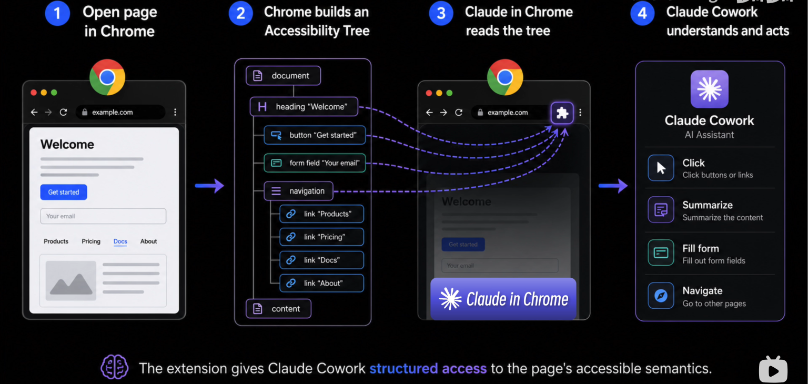
</p>

<p align="center"><sub>图：Computer Use 与 Claude in Chrome</sub></p>

<br>

### 一个典型用法：抓 X 和 YouTube 的信息

如果想收集 **X 和 YouTube** 上的信息，**用 Cowork 直接爬虫就不太方便**，因为这两个平台对爬虫限制得很严。

安装 **Claude in Chrome** 插件后，你就可以让它**去 X 上面看看某个用户最近三天发了什么动态**。

这时**用户的鼠标会出现一个棕色的光圈** —— 这就是 Cowork 插件在自己操作浏览。

> ⚠️ **下面这个开关注意保持关闭**，因为打开之后插件就会自由浏览、操作任何网站。

<p align="center">
  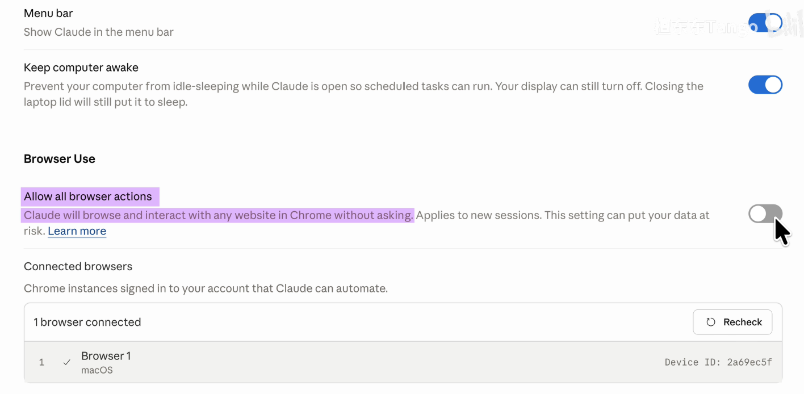
</p>

<p align="center"><sub>图：用 Claude in Chrome 抓取 X 上的动态</sub></p>

<br>

---

<br>

## 十五、写在最后

**总结：Cowork 真的很强。**

回顾一下整条学习路径：

1. **先理解架构** —— Cowork 是 Agent，默认联网、默认能操作本地文件；
2. **再立规矩** —— 用三级 Instructions 和两种 Memory 把偏好固化下来；
3. **然后放手交办** —— 只描述目标，路径和工具让它自己规划；
4. **不够再扩展** —— Connector 接外部抓手，Skill 提升专项能力，Plugin 打包整套工作流；
5. **最后自动化** —— Scheduled 定时跑、Live Artifacts 实时看、Dispatch 远程指挥。

> 🚀 **Cowork 不会给你情绪价值，但它是一个很好的下属。**
> 提前对齐要求，它就能省时省力；它会反思、会改正，还会主动跟你商量方案。

<p align="center">
  
</p>

<br>

---

<br>

<div align="center">

**本文整理自 B 站 @檀东东《Claude Cowork 30 分钟超全教程》**

仅供学习交流，版权归原作者所有

</div>
